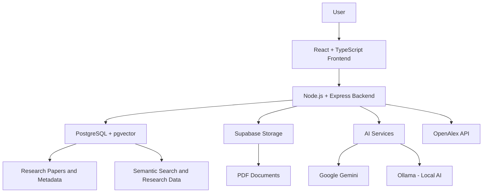

# ResearchFlow 🔬

### Your AI-Powered Workspace for Research Exploration and Discovery

ResearchFlow is an AI-powered research workspace designed to help students and academic researchers organize literature, understand research papers, compare existing approaches, and discover potential research directions.

Reading and analyzing multiple research papers manually can be time-consuming. ResearchFlow brings essential research activities into one platform, allowing users to interact with their literature, explore connections between studies, and investigate potential research gaps.

**Live Application:** https://researchflow-henna.vercel.app

**GitHub Repository:** https://github.com/muskan-rathor/-ResearchFlow

---

## 🚀 Key Features

### 📚 1. Research Workspace and Paper Library

- Create workspaces for different research topics.
- Upload academic research papers in PDF format.
- Keep research materials organized in one place.
- Access uploaded papers within their respective workspaces.

### 💬 2. AI Research Assistant

Interact with your uploaded research papers using natural-language questions.

- Ask questions about your research literature.
- Get AI-generated answers based on relevant information from uploaded papers.
- Understand complex research concepts more easily.
- Explore information without manually searching through lengthy documents.

### 🔎 3. Semantic Research Search

Find relevant information across your uploaded literature using natural-language queries.

- Search based on the meaning and context of a question.
- Retrieve relevant information from multiple research papers.
- Explore your research collection beyond exact keyword matching.

### 📊 4. Research Paper Comparison

Compare multiple research papers to understand their similarities and differences.

ResearchFlow helps explore:

- Research problems and objectives
- Methodologies and approaches
- Datasets used
- Key findings and contributions
- Limitations
- Future research directions

This helps researchers understand how different studies approach similar problems.

### 🧠 5. Research Gap Discovery Engine

One of the core features of ResearchFlow is its research gap discovery capability.

Instead of analyzing each paper independently, ResearchFlow examines the research limitations across an uploaded collection to identify recurring patterns and potential research opportunities.

It helps identify:

- Repeated limitations across different papers.
- Commonly explored research directions.
- Underexplored areas within the collected literature.
- Potential opportunities for further investigation.

### 🌐 6. External Literature Validation

ResearchFlow integrates with OpenAlex to explore external academic literature.

This provides additional context for investigating potential research gaps and understanding whether similar research directions have already been explored.

### 📄 7. Structured Research Reports

Generate structured research-gap reports containing insights from the uploaded research collection and relevant external literature.

These reports help researchers organize their findings and plan future research directions.

> **Important:** ResearchFlow identifies potential research gaps, not guaranteed novel contributions. Researchers should independently verify novelty through a broader literature review.

---

## 🏗️ System Architecture

ResearchFlow follows a client-server architecture with separate frontend and backend services.



### How the application works

1. Users create research workspaces and upload academic papers.
2. ResearchFlow extracts and processes the uploaded literature.
3. Users interact with their research collection through AI-powered search and question answering.
4. Users compare papers and explore research limitations.
5. The Research Gap Engine analyzes patterns across papers.
6. External academic literature provides additional context for potential research directions.
7. Structured reports help users organize their research findings.

---

## 🛠️ Technology Stack

| Category | Technologies |
|---|---|
| Frontend | React.js, TypeScript, Vite |
| Styling | Tailwind CSS |
| State Management | Zustand |
| Routing | React Router |
| Backend | Node.js, Express.js |
| Database | PostgreSQL |
| Vector Search | pgvector |
| File Storage | Supabase Storage |
| AI Integration | Google Gemini API, Ollama |
| Embedding Models | Hugging Face Transformers |
| Authentication | JWT, bcrypt |
| External Academic Data | OpenAlex API |
| Deployment | Vercel, Render, Supabase |

---

## 📂 Project Structure

```text
ResearchFlow/
│
├── frontend/
│   ├── src/
│   │   ├── components/
│   │   ├── pages/
│   │   ├── services/
│   │   ├── store/
│   │   └── ...
│   ├── package.json
│   └── vite.config.ts
│
├── backend/
│   ├── src/
│   │   ├── config/
│   │   ├── controllers/
│   │   ├── middleware/
│   │   ├── repositories/
│   │   ├── routes/
│   │   ├── scripts/
│   │   ├── services/
│   │   ├── validators/
│   │   ├── app.js
│   │   └── server.js
│   │
│   ├── migrations/
│   ├── uploads/
│   └── package.json
│
└── README.md
```

---

## ⚙️ Getting Started

Follow these instructions to run ResearchFlow locally.

### Prerequisites

Make sure you have installed:

- Node.js (LTS recommended)
- npm
- Git
- Docker Desktop
- A Supabase project with PostgreSQL and pgvector support
- A Google Gemini API key if using Gemini

### 1. Clone the repository

```bash
git clone https://github.com/muskan-rathor/-ResearchFlow.git

cd -ResearchFlow
```

### 2. Set up the backend

```bash
cd backend

npm install
```

Create a `.env` file inside the `backend` directory.

Add the following configuration:

```env
PORT=5000
NODE_ENV=development

# Database
DB_HOST=127.0.0.1
DB_PORT=5433
DB_NAME=researchflow
DB_USER=researchflow
DB_PASSWORD=your_database_password
DB_SSL=false

# Authentication
JWT_SECRET=your_secure_jwt_secret
JWT_EXPIRES_IN=1d

# AI Configuration
LLM_PROVIDER=gemini
GEMINI_API_KEY=your_gemini_api_key
GEMINI_MODEL=your_available_gemini_model_id

# Optional local AI configuration
OLLAMA_BASE_URL=http://localhost:11434
OLLAMA_MODEL=qwen2.5:3b

# Supabase Storage
SUPABASE_URL=your_supabase_project_url
SUPABASE_SECRET_KEY=your_supabase_secret_key
SUPABASE_STORAGE_BUCKET=research-papers
```

**Important:** Never commit your `.env` file or expose API keys, database passwords, or Supabase secret keys.

### 3. Start PostgreSQL using Docker

The project uses PostgreSQL with the pgvector extension.

If your local Docker Compose configuration is available, start the database from the repository root:

```bash
docker compose up -d
```

Make sure the database configuration matches your backend environment variables.

### 4. Run database migrations

From the backend directory:

```bash
node src/scripts/migrate.js
```

This creates the required database tables and schema.

### 5. Start the backend server

```bash
npm start
```

The backend should be available at:

```text
http://localhost:5000
```

Health check:

```text
http://localhost:5000/api/v1/health
```

### 6. Set up the frontend

Open another terminal:

```bash
cd frontend

npm install
```

Create a `.env` file inside the `frontend` directory:

```env
VITE_API_URL=http://localhost:5000/api/v1
```

Start the frontend:

```bash
npm run dev
```

Open the application:

```text
http://localhost:5173
```

---

## 🔐 Authentication and Security

ResearchFlow includes:

- User registration and login.
- Password hashing using bcrypt.
- JWT-based authentication.
- Protected workspace and research operations.
- Environment-based configuration for sensitive credentials.
- Private Supabase Storage for uploaded research documents.

---

## 🌍 Deployment

ResearchFlow is deployed using the following services:

| Component | Platform |
|---|---|
| Frontend | Vercel |
| Backend | Render |
| Database | Supabase PostgreSQL |
| PDF Storage | Supabase Storage |

**Live application:** https://researchflow-henna.vercel.app

**Backend health endpoint:** https://researchflow-backend-ci9p.onrender.com/api/v1/health


## 🔮 Future Improvements

Some planned improvements for ResearchFlow include:

- Export research reports as PDF.
- Expand integrations with academic literature sources.
- Improve research-gap validation and ranking.
- Add collaborative research workspaces.
- Introduce citation and reference management.
- Improve AI response evaluation and source attribution.

---

## 🎯 Project Objective

ResearchFlow aims to make academic literature exploration more organized and efficient by combining AI-powered paper understanding, literature comparison, semantic search, and potential research-gap discovery in a single workspace.

It is designed to support researchers throughout the literature exploration process — from understanding existing work to identifying directions for further investigation.

---

## 👩‍💻 Author

**Muskan Rathore**

Integrated B.Tech + M.Tech in Information Technology  
ABV-IIITM Gwalior

[GitHub](https://github.com/muskan-rathor)

---

## 📜 License

This project is developed for academic and educational purposes.

Add a formal open-source license if you intend to permit others to use, modify, and distribute the project.